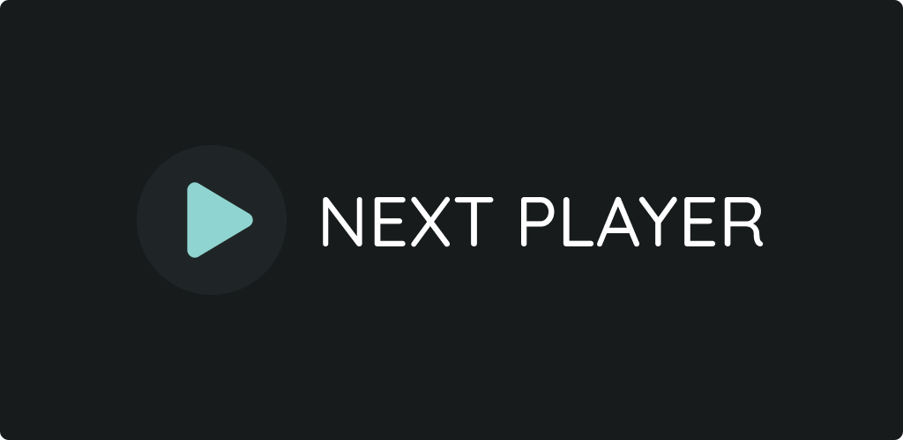

# Kinetix

**Kinetix** is a next-gen, glassmorphic Media3 video player for Android written in Kotlin and Jetpack Compose. Engineered for smooth performance and immersive viewing, Kinetix pairs modern design aesthetics with advanced playback controls and media indexing.

**This project is actively maintained. Please report any issues or feature requests in the [Issues](https://github.com/anilbeesetti/nextplayer/issues) section.**

> For GitHub releases, you can verify the app with the SHA-256 fingerprint certificate: `D3:7C:AB:F3:67:6C:F5:82:24:FB:24:2C:8D:D2:09:12:9D:05:88:03:79:29:5F:AA:A6:D0:FB:60:7B:EC:13:1B`

## Key Highlights

- **Global/Per-Video Persistent Playback Speed**: Configure speed globally or remember playback pace individually per video.
- **Long-Press + Horizontal Drag Dynamic Speed Scrubbing**: Seamlessly scrub playback speed dynamically on the fly with fluid touch gestures.
- **Built-in Online Subtitle Search & Auto-Attach**: Search online subtitles directly inside the player and automatically attach matching tracks.
- **Animated Glassmorphic Jetpack Compose UI**: Beautiful, modern translucent interfaces crafted with smooth Compose animations and Material You dynamic themes.
- **High-Speed Batch MediaStore Indexing**: Rapid discovery and categorization of local video libraries and folders with minimal battery and memory overhead.

## Screenshots

### Phone

[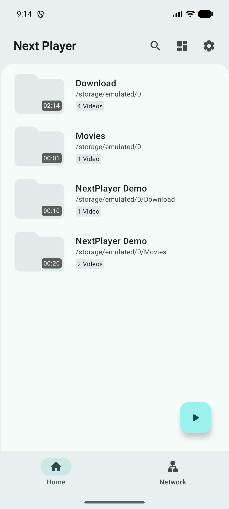](fastlane/metadata/android/en-US/images/phoneScreenshots/1.png)
[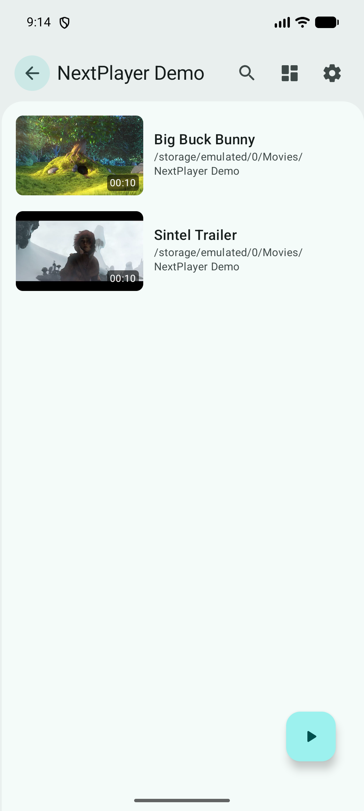](fastlane/metadata/android/en-US/images/phoneScreenshots/2.png)
[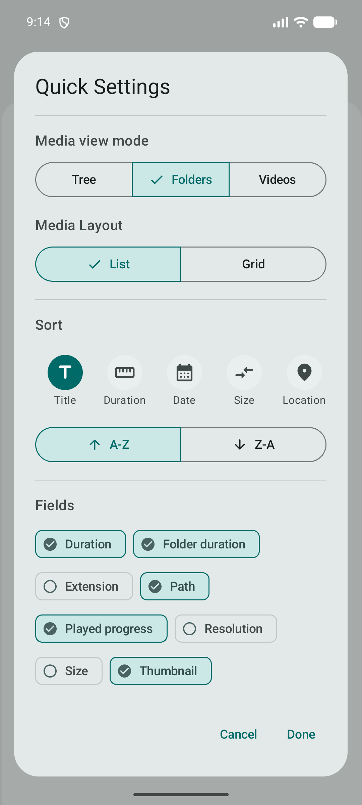](fastlane/metadata/android/en-US/images/phoneScreenshots/3.png)
[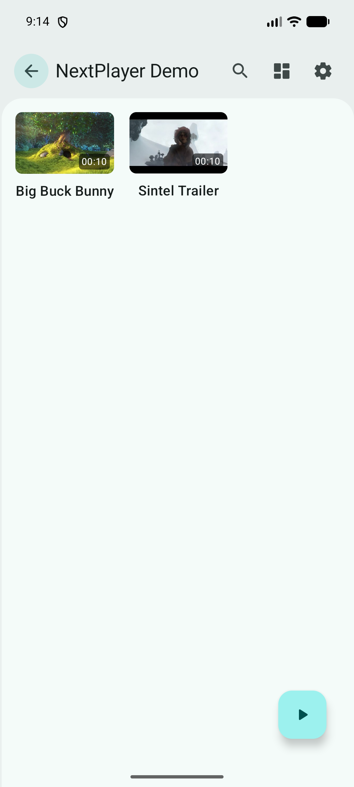](fastlane/metadata/android/en-US/images/phoneScreenshots/4.png)
[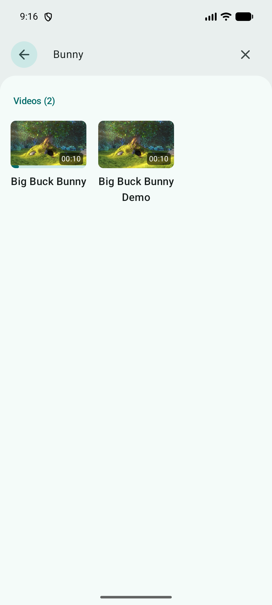](fastlane/metadata/android/en-US/images/phoneScreenshots/6.png)
[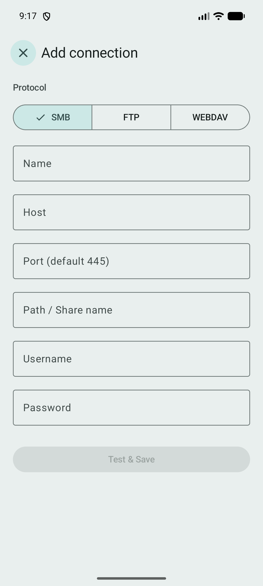](fastlane/metadata/android/en-US/images/phoneScreenshots/7.png)
[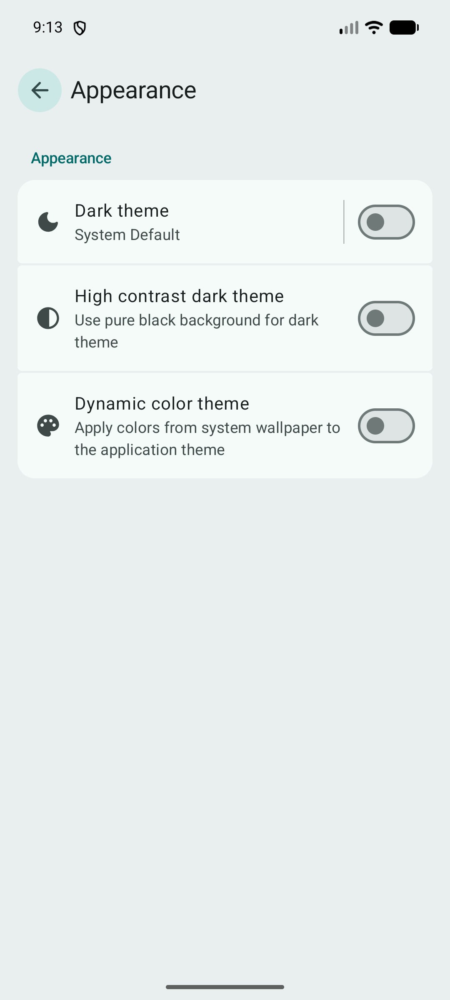](fastlane/metadata/android/en-US/images/phoneScreenshots/8.png)

### Player UI

[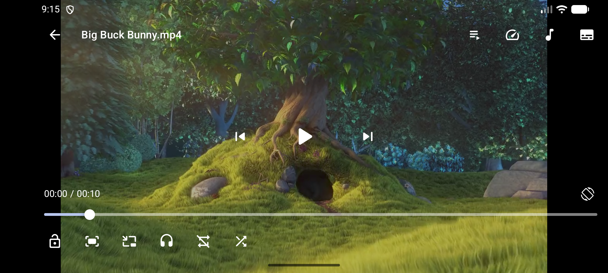](fastlane/metadata/android/en-US/images/phoneScreenshots/5.png)
[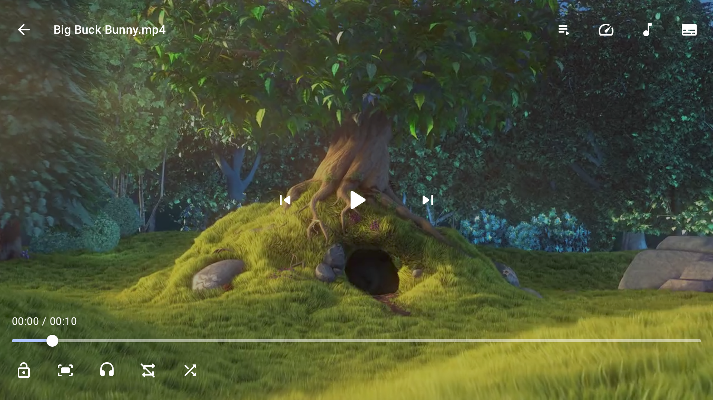](fastlane/metadata/android/en-US/images/tvScreenshots/3.png)

### Android TV

[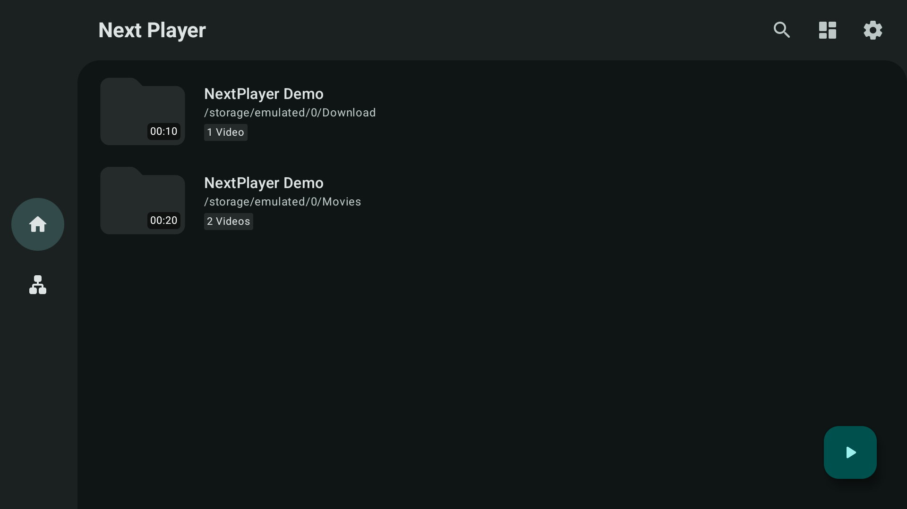](fastlane/metadata/android/en-US/images/tvScreenshots/1.png)
[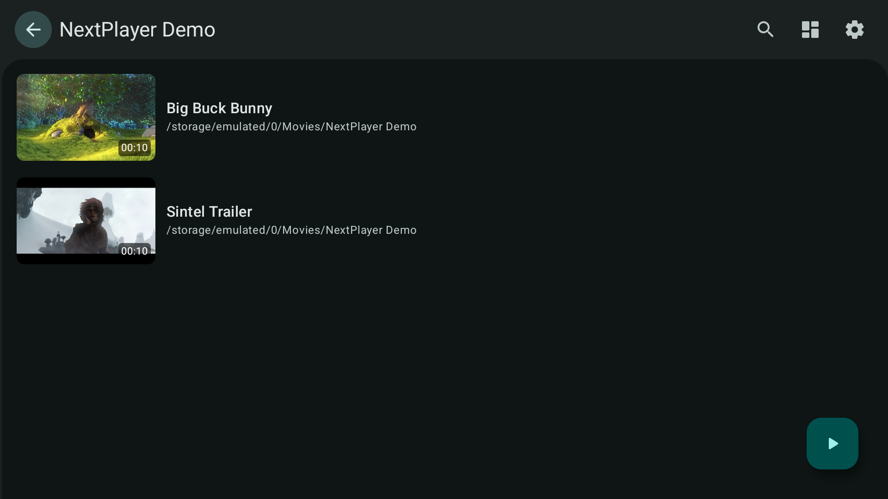](fastlane/metadata/android/en-US/images/tvScreenshots/2.png)
[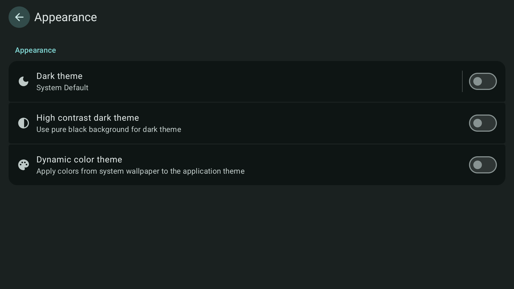](fastlane/metadata/android/en-US/images/tvScreenshots/4.png)

## Player intent API

Kinetix supports MX Player-compatible VIEW intents, with additional playback
speed and direct background-play options. See the [Player intent API reference](PLAYER_API.md)
for integration examples, supported extras, URI permissions, playback results,
and compatibility details.

## Supported formats

- **Video**: H.263, H.264 AVC (Baseline Profile; Main Profile on Android 6+), H.265 HEVC, MPEG-4 SP, VP8, VP9, AV1
    - Support depends on Android device
- **Audio**: Vorbis, Opus, FLAC, ALAC, PCM/WAVE (μ-law, A-law), MP1, MP2, MP3, AMR (NB, WB), AAC (LC, ELD, HE; xHE on Android 9+), AC-3, E-AC-3, DTS, DTS-HD, TrueHD
    - Support provided by ExoPlayer FFmpeg extension
- **Subtitles**: SRT, SSA, ASS, TTML, VTT, DVB
    - SSA/ASS styling supported with embedded styles option

## Features

- Native Android app with fluid and intuitive interface
- Completely free, open source, and ad-free
- Hardware and software decoders (MediaCodec & bundled FFmpeg)
- Audio/Subtitle track selection and embedded styles
- Vertical swipe to change brightness (left) / volume (right)
- Horizontal swipe to seek through video
- Material 3 (You) dynamic color theming
- Media picker with tree, folder, and file view modes
- Direct network stream and URL playback
- Storage Access Framework (SAF) document picker integration
- Picture-in-picture mode & background playback
- Android TV support with DPAD navigation
- Private encrypted/PIN-protected Vault
- Network storage support (SMB/FTP/SFTP/WebDAV)
- Local and M3U URL/file playlist support

## Contributing

Contributions are welcome!

### Developer documentation

- [Runtime decoder switching](feature/player/DECODER_SWITCHING.md)

### Translating

You can help translate Kinetix on [Hosted Weblate](https://hosted.weblate.org/engage/next-player/).

## Credits

### Open Source Projects

- [Findroid](https://github.com/jarnedemeulemeester/findroid)
- [Just (Video) Player](https://github.com/moneytoo/Player)
- [LibreTube](https://github.com/libre-tube/LibreTube)
- [ReadYou](https://github.com/Ashinch/ReadYou)
- [Seal](https://github.com/JunkFood02/Seal)

### Special Thanks

Thanks to **Weblate** for providing free hosting for the project.

## License

Kinetix is licensed under the GNU General Public License v3.0. See the [LICENSE](LICENSE) file for more information.
